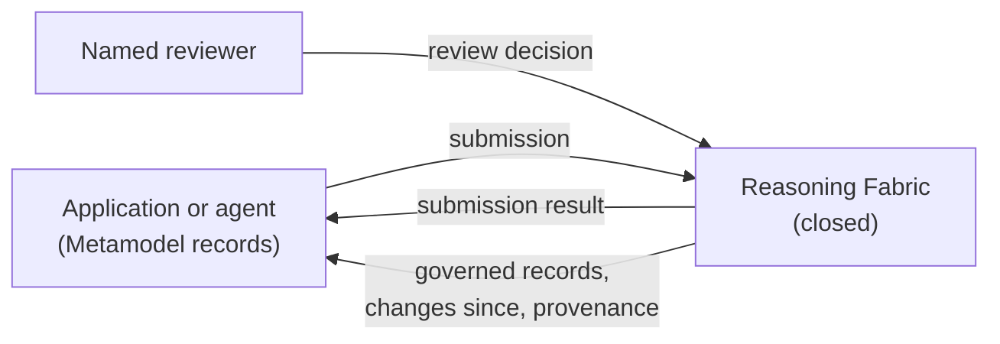

# Reasoning Fabric connector

The Reasoning Fabric connector is the published interface between the open Triodian Metamodel and the Reasoning Fabric, a closed, private service that governs records written against the Metamodel. Through the connector, an application or agent submits Metamodel records, gets them validated, and receives them back with provenance. It does this without learning how the Fabric works.

This folder is the contract. It sets out what each side must do, and the Metamodel schemas define the message shapes:

| Schema | What it is |
| --- | --- |
| [`schemas/connector/submission.schema.json`](../schemas/connector/submission.schema.json) | A batch of change proposals sent to the Fabric |
| [`schemas/connector/change-proposal.schema.json`](../schemas/connector/change-proposal.schema.json) | One proposed change to one record, with its evidence |
| [`schemas/connector/submission-result.schema.json`](../schemas/connector/submission-result.schema.json) | The Fabric's answer: validity, match, conflicts, confidence and treatment for each proposal |
| [`schemas/connector/review-decision.schema.json`](../schemas/connector/review-decision.schema.json) | A named person's decision on a queued proposal |
| [`schemas/connector/governed-record.schema.json`](../schemas/connector/governed-record.schema.json) | A published version of a record, as applications read it |
| [`schemas/connector/provenance-record.schema.json`](../schemas/connector/provenance-record.schema.json) | One append-only, hash-chained entry in the provenance ledger |
| [`schemas/connector/dataset-policy.schema.json`](../schemas/connector/dataset-policy.schema.json) | The published rules a dataset runs under |

[`openapi.yaml`](openapi.yaml) binds these messages to HTTP. [`policies/`](policies) holds the published dataset policies, starting with the [AI Obligations Atlas](policies/ai-obligations-atlas.policy.json).

**Versions.** This is connector contract version **1.0.0**. It is written against the Metamodel version in [`../VERSION`](../VERSION). Both use semantic versioning. A minor version only adds optional fields or new enumerated values. A major version may remove or change fields. A Fabric serves one major version of the contract at a time, under `/connector/v{major}`.

## What each side does

**The Metamodel** (this repository, open) publishes:
- the record schemas;
- the connector message schemas;
- the HTTP binding;
- the dataset policies.

A record that validates here is a record the Fabric can accept. The Metamodel never describes how the Fabric reaches its outcomes.

**The Reasoning Fabric** (closed) implements the contract. For each proposal it:

1. **Validates** the record against the schema for its `target.domainType`, at the Metamodel version named in the submission. It also checks the dataset's language rules.
2. **Canonicalises and matches** the record against existing records, so that one instrument or provision is never entered twice. A match is reported as `matchedEntityID`.
3. **Arbitrates** conflicts between sources, and between the proposal and the current record, using the dataset's source precedence and date precedence. Each conflict is reported as resolved (with the rule ID) or unresolved.
4. **Scores** confidence from the reliability, recency and corroboration of the evidence, and flags records past their freshness threshold as stale.
5. **Gates** the proposal under the dataset's autonomy rules, and assigns a treatment.
6. **Records** every step in the provenance ledger.

Results and provenance name the published rules applied (for example `autonomy.statusDateTier.reviewQueue` or `precedence.leadOnly`). They do not describe the method behind them.

**Applications** (for example the AI Obligations Atlas) must:
- submit records that validate against the Metamodel;
- read only governed records;
- show each record together with its source link, tier and last-verified date;
- cite the governed record ID or a provenance record ID wherever a record is quoted.

They must not present a `pendingReview` record as published.

## Records and identifiers

- Every record carries its own identifier, named after its entity (`obligationID`, `useCaseID`, `externalOrgID`). Records link to each other by these identifiers, or by the shared `entityReference` (`domainType` + `entityID`).
- A **governed record ID** is the entity ID, `@` and the version: `OBL-AU-CPS230-48@2`. Versions start at 1 and increase by one with every publication. Earlier versions are kept, marked `superseded`.
- A proposal names the version it was made against in `baseVersion`. If the record has moved on, the Fabric rejects the proposal with `version.stale`, and the submitter re-reads the record and proposes again.
- `submissionID` and `changeProposalID` are assigned by the submitter and must be unique within the dataset. Resubmitting a submission ID returns the original result and changes nothing.
- Leads (commentary or news that points to an official source) are Trigger records. Their `instrumentChange.sourceRank` is 4 or 5, and they are published unverified.

## Treatments

| Treatment | Meaning | What the application may show |
| --- | --- | --- |
| `publishedUnverified` | Published automatically, not reviewed | Shown, marked unverified |
| `published` | Published automatically (reverification only) | Shown |
| `reviewQueue` | Waiting for a named approver | Not shown to users until approved |
| `escalated` | An unresolved conflict, sent to the method owner | Not shown until decided |
| `convertedToLead` | The evidence (rank 4 or 5) cannot set a status or date alone, so it is kept as a lead | The lead, marked unverified |
| `rejected` | Invalid, stale or a duplicate | Nothing |

Nothing that changes a status, a date or a tier is published without a review decision from a named person. That person is recorded in `approval` on the governed record, and in the ledger.

## Provenance ledger

The ledger is append-only. Each entry carries:
- `sequence`;
- `previousHash`: the previous entry's hash, or empty for the first entry;
- `hash`: SHA-256, hex encoded, of the entry's canonical JSON with the `hash` field removed. Canonical JSON means keys sorted at every level and no insignificant whitespace.

Anyone holding a run of entries can recompute the hashes and confirm that none were altered or removed. Entries record what happened, who or what acted, the evidence URLs, the rule IDs and the resulting confidence. They contain no client facts.

## HTTP binding

See [`openapi.yaml`](openapi.yaml). In summary, under `/connector/v1`:

| Method and path | Purpose |
| --- | --- |
| `GET /policy/{dataset}` | The dataset policy in force |
| `POST /submissions` | Submit proposals (`mode: validate` or `propose`) |
| `GET /submissions/{submissionID}` | The result of an earlier submission |
| `GET /records/{dataset}` | Governed records, filtered by `domainType`, `publicationStatus`, `updatedSince` |
| `GET /records/{dataset}/{entityID}` | The current version of a record (`?version=` for an earlier one) |
| `GET /changes/{dataset}?since=` | Versions published, superseded or removed since a time |
| `GET /proposals/{dataset}?treatment=reviewQueue` | Proposals waiting for review (reviewer scope) |
| `POST /reviews` | Record a review decision (reviewer scope) |
| `GET /provenance/{provenanceRecordID}` | One ledger entry |
| `GET /provenance?subject={entityID}` | The ledger entries for a record, oldest first |

Authentication is a bearer token per client, carrying one or more of three scopes:
- `submit`: agents and data pipelines;
- `read`: applications;
- `review`: named reviewers. A review token identifies one person.

Errors use `application/problem+json` with a stable `code`. The binding also defines rate limits per client.

## Language rules

Dataset policies can carry language rules. The Fabric checks records against them on submission, and applications check their responses against them before sending. For the AI Obligations Atlas, the rules put the dataset's standing rule into practice: records state what sources say and how they are classified, and never what the law requires of a particular client. Specifically:
- tier words describe sources;
- "required" is kept for counsel's determination;
- nothing states that anyone is compliant or in breach;
- an Anticipated record shows its trigger date or status, never a likelihood that it will pass.

## Conformance

A Fabric conforms to connector 1.0 if it:
1. accepts every valid submission, and rejects invalid ones with `schema.*` issue codes;
2. never publishes a status, date or tier change without a review decision;
3. returns governed records that validate against `governed-record.schema.json`, with records that validate against their domain schemas;
4. keeps a ledger whose hash chain verifies;
5. applies the published dataset policy, and cites its rule IDs.

The Fabric's own test suite checks these five points.
