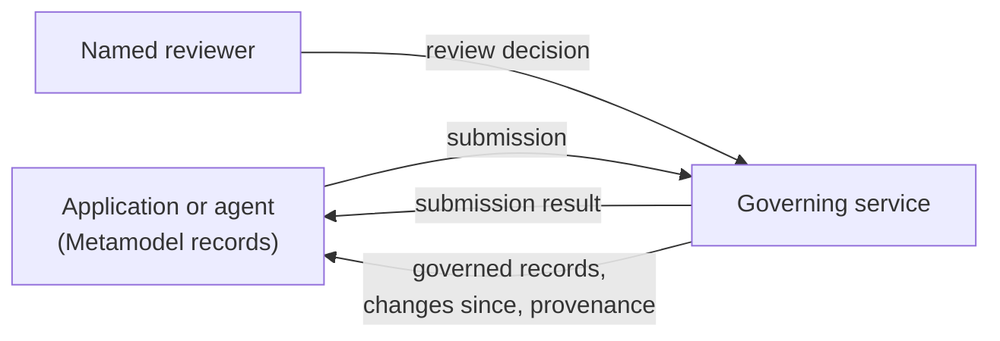

# Governance interface

The governance interface is a contract for services that govern records written against the Triodian Metamodel. An application or agent submits records to such a governing service, which validates them, routes changes that need a person to a named reviewer, and returns published records with a provenance trail. The contract says what a governing service does, not how it does it.

The message shapes are Metamodel schemas:

| Schema | What it is |
| --- | --- |
| [`schemas/governance/submission.schema.json`](../schemas/governance/submission.schema.json) | A batch of change proposals sent to a governing service |
| [`schemas/governance/change-proposal.schema.json`](../schemas/governance/change-proposal.schema.json) | One proposed change to one record, with its evidence |
| [`schemas/governance/submission-result.schema.json`](../schemas/governance/submission-result.schema.json) | The service's answer: validity, match, conflicts, confidence and treatment for each proposal |
| [`schemas/governance/review-decision.schema.json`](../schemas/governance/review-decision.schema.json) | A named person's decision on a queued proposal |
| [`schemas/governance/governed-record.schema.json`](../schemas/governance/governed-record.schema.json) | A published version of a record, as applications read it |
| [`schemas/governance/provenance-record.schema.json`](../schemas/governance/provenance-record.schema.json) | One append-only, hash-chained entry in the provenance ledger |
| [`schemas/governance/dataset-policy.schema.json`](../schemas/governance/dataset-policy.schema.json) | The rules a governed dataset runs under |

[`openapi.yaml`](openapi.yaml) binds these messages to HTTP. [`example-policies/`](example-policies) holds an example dataset policy for a regulatory register.

**Versions.** This is governance interface version **1.0.0**. It is written against the Metamodel version in [`../VERSION`](../VERSION). Both use semantic versioning:
- A minor version only adds optional fields or new enumerated values.
- A major version may remove or change fields.

A governing service serves one major version of the interface at a time, under `/governance/v{major}`.

## What each party does

**The Metamodel** publishes:
- the record schemas;
- the message schemas;
- the HTTP binding.

A record that validates here is a record a governing service can accept.

**A governing service** implements the contract. For each proposal it:

1. **Validates** the record against the schema for its `target.domainType`, at the Metamodel version named in the submission, and checks the dataset's language rules.
2. **Matches** the record to records already held, so that one real-world item is never entered twice, and reports a match as `matchedEntityID`.
3. **Arbitrates** conflicts between sources, and between the proposal and the current record, using the dataset's source precedence and date precedence. Each conflict is reported as resolved (with the rule ID) or unresolved.
4. **Scores** confidence from the evidence, and flags records past their freshness threshold as stale.
5. **Gates** the proposal under the dataset's autonomy rules, and assigns a treatment.
6. **Records** every step in the provenance ledger.

Results and provenance name the rules applied (for example `autonomy.statusDateTier.reviewQueue`). Whether to publish how they are computed is the service's choice.

**Applications**:
- submit records that validate against the Metamodel;
- read only governed records;
- cite the governed record ID or a provenance record ID wherever a record is quoted;
- never present a `pendingReview` record as published.

## Records and identifiers

- Every record carries its own identifier, named after its entity (`obligationID`, `useCaseID`, `externalOrgID`). Records link to each other by these identifiers, or by the shared `entityReference` (`domainType` + `entityID`).
- A **governed record ID** is the entity ID, `@`, and the version, e.g. `OBL-AU-CPS230-48@2`. Versions start at 1 and increase by one with every publication. Earlier versions are kept, marked `superseded`.
- A proposal names the version it was made against in `baseVersion`. If the record has moved on, the service rejects the proposal with `version.stale`, and the submitter must read the record again before proposing.
- `submissionID` and `changeProposalID` are assigned by the submitter and must be unique within the dataset. Resubmitting a submission ID returns the original result and changes nothing.
- Leads (commentary or news that points to an official source) are Trigger records with `instrumentChange.sourceRank` 4 or 5. They are published unverified.

## Treatments

| Treatment | Meaning | What the application may show |
| --- | --- | --- |
| `publishedUnverified` | Published automatically, not reviewed | Shown, marked unverified |
| `published` | Published automatically (reverification only) | Shown |
| `reviewQueue` | Waiting for a named approver | Not shown to users until approved |
| `escalated` | An unresolved conflict, sent to the method owner | Not shown until decided |
| `convertedToLead` | The evidence cannot set a status or date alone, so it is kept as a lead | The lead, marked unverified |
| `rejected` | Invalid, stale or a duplicate | Nothing |

Which changes need a review decision is set by the dataset policy. Every approval is recorded in `approval` on the governed record, and in the ledger.

## Provenance ledger

The ledger is append-only. Each entry carries:
- `sequence`;
- `previousHash`: the previous entry's hash, or empty for the first entry;
- `hash`: SHA-256, hex encoded, of the entry's canonical JSON with the `hash` field removed. Canonical JSON means keys sorted at every level and no insignificant whitespace.

Anyone holding a run of entries can recompute the hashes and confirm that none was altered or removed.

## HTTP binding

See [`openapi.yaml`](openapi.yaml). In summary, under `/governance/v1`:

| Method and path | Purpose |
| --- | --- |
| `GET /policy/{dataset}` | The dataset policy in force |
| `POST /submissions` | Submit proposals (`mode: validate` or `propose`) |
| `GET /submissions/{submissionID}` | The result of an earlier submission |
| `GET /records/{dataset}` | Governed records, filtered by `domainType`, `publicationStatus`, `updatedSince` |
| `GET /records/{dataset}/{entityID}` | The current version of a record (`?version=` for an earlier one) |
| `GET /changes/{dataset}?since=` | Versions published, superseded or removed since a time |
| `GET /proposals/{dataset}?treatment=reviewQueue` | Proposals waiting for review (reviewer scope) |
| `POST /reviews` | Record a review decision (reviewer scope) |
| `GET /provenance/{provenanceRecordID}` | One ledger entry |
| `GET /provenance?subject={entityID}` | The ledger entries for a record, oldest first |

Authentication is a bearer token per client, with one or more of three scopes:
- `submit`: agents and data pipelines;
- `read`: applications;
- `review`: named reviewers. A review token identifies one person.

Errors use `application/problem+json` with a stable `code`.

## Dataset policies

A dataset policy sets:
- source precedence: which sources can set a status or date alone;
- autonomy rules: which changes publish automatically and which wait for a named reviewer;
- date precedence;
- freshness thresholds;
- confidence bands;
- language rules: patterns that records and responses must not contain.

The [example policy](example-policies/regulatory-register.policy.json) is for a register of regulatory obligations. It ranks official text above regulator publications, standards bodies, commentary and news. It sends every create, status, date or tier change to review. Its language rules keep records to what sources say: they never tell a reader what to do, state that anyone is compliant or in breach, or predict that a proposal will pass.

## Conformance

A governing service conforms to the interface if it:
1. accepts every valid submission and rejects invalid ones with `schema.*` issue codes;
2. publishes nothing that its dataset policy routes to review without a review decision;
3. returns governed records that validate against `governed-record.schema.json`, and whose records validate against their domain schemas;
4. keeps a ledger whose hash chain verifies;
5. applies its dataset policy and cites the policy's rule IDs.
